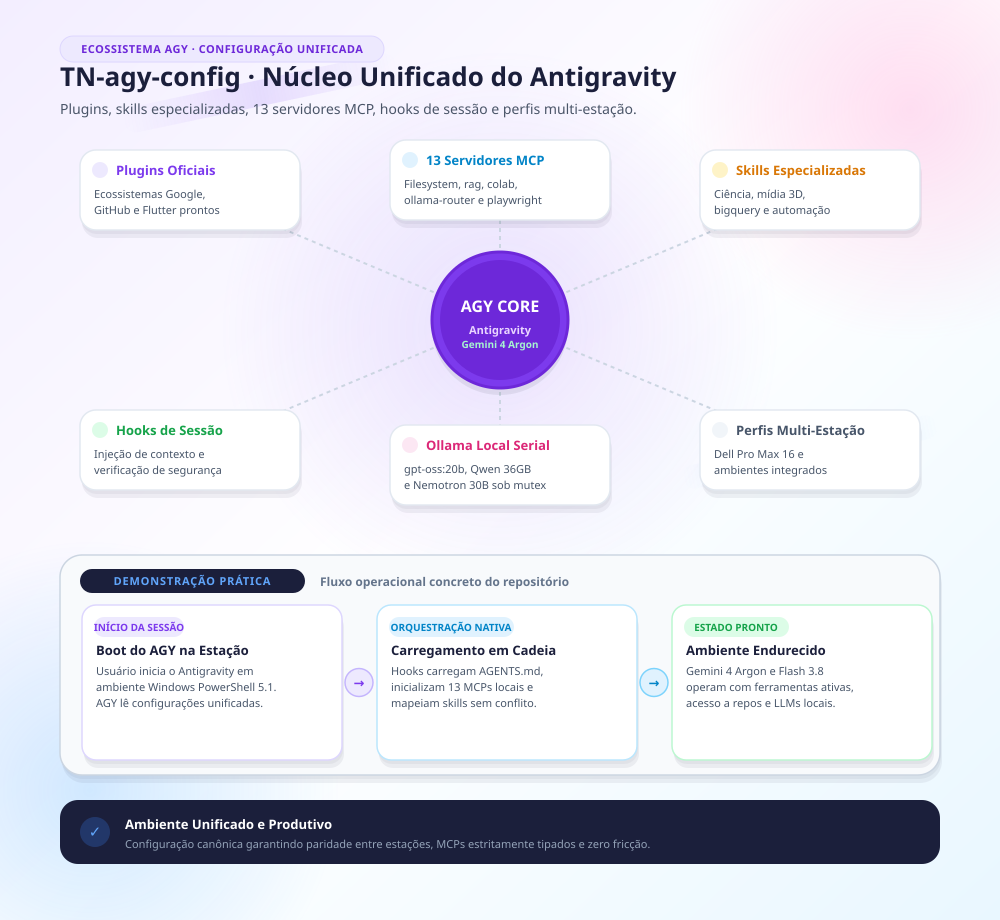

# TN-agy-config — Configuração Unificada do Google Antigravity (AGY)

> **Ecossistema declarativo completo para o Google Antigravity (AGY): plugins com curadoria, skills especializadas, catálogo de agentes, servidores MCP, templates de hooks e hierarquia de modelos em escada com preservação estrita de contexto.**


*Para visualização técnica complementar em diagrama de blocos com paleta Okabe-Ito, veja o [Diagrama Técnico](docs/roteamento-tokens-agy.png) ou o arquivo vetorial [SVG](docs/roteamento-tokens-agy.svg).*

---

## 🏛️ 1. Premissa Operacional & Hierarquia em Escada (v2.2.0)

> **Diretriz Soberana:** Não há camada ou filtro automático de restrição. O usuário é o soberano exclusivo sobre os dados e tarefas inseridas na sessão. O Antigravity atua estritamente para **analisar a complexidade técnica e distribuir a execução entre as camadas mais eficientes e econômicas**.

| Camada | Escada de Modelos | Atribuição Operacional |
| :--- | :--- | :--- |
| **1. Cérebro Orquestrador** | **1º `Gemini 4 Argon`** → **2º `Claude Opus`** (`Opus 5.5`) | Analisa o comando, planeja (`implementation_plan.md`), decide arquitetura e trade-offs, sintetiza entregas e **comanda a distribuição aos agentes rápidos e modelos locais**. Protegido contra leitura bruta (> 3 arquivos). |
| **2. Agentes Rápidos** | **1º `Gemini 3.8 Flash`** → **2º `Claude Sonnet`** (`Sonnet 5.5`) | **SEM LIMITE de tamanho de arquivo ou linhas**: lê arquivos, logs volumosos e CSVs em contexto isolado, devolvendo ao Cérebro síntese executiva limpa de 1 a 3 parágrafos. **Distribui tarefas aos modelos locais (Camada 3) sob demanda do Cérebro.** |
| **3. Executores Locais (Ollama)** | `dsh-local` (`gpt-oss:20b`), `qwen-local` (`Qwen3-Coder-Next :NOTPL`), `opencode-local` (`nemotron-3.5-lightning:30b-a3b`), MCP `ollama-router` | Execução mecânica local a **custo zero de tokens/créditos**: lotes volumosos (≥ 5 arquivos), refatorações de boilerplate e buscas semânticas locais. |
| **4. Contingência Automática** | **Plano A:** OmniRoute + compressão RTK → **Plano B:** `ollama-router` / `claude-local` | Comutação automática em caso de saturação de cota (`HTTP 429`) ou perda de conectividade. |

---

## 📂 2. Estrutura do Repositório Público

```text
TN-agy-config/
├── config/
│   ├── agents/                   # Catálogo de agentes especializados (GSD, revisão, arquitetura)
│   ├── plugins/                  # Plugins ativos (token-router, cartographer, claude-code-setup)
│   ├── skills/                   # Skills com curadoria ativa (engenharia, visualização, GCP, dados)
│   ├── AGENTS.md                 # Regras globais de escada e limites operacionais
│   ├── hooks.example.json        # Template de ciclo de vida (SessionStart, PreInvocation, Stop)
│   └── mcp_config.example.json   # Template de servidores MCP (ollama-router, github, context7)
├── antigravity/
│   └── settings.example.json     # Template de configurações gerais do editor/ambiente
├── docs/
│   ├── arquitetura-motion.png    # Diagrama em Estilo Motion (renderização em alta definição)
│   ├── arquitetura-motion.svg    # Diagrama em Estilo Motion (vetorial)
│   ├── roteamento-tokens-agy.png # Diagrama técnico de blocos (paleta Okabe-Ito)
│   └── roteamento-tokens-agy.svg # Diagrama técnico de blocos (vetorial)
├── scripts/
│   ├── gerar_diagrama_motion.py  # Script gerador do infográfico Motion via Chrome headless
│   └── gerar_svg_roteamento.py   # Script gerador do diagrama técnico de roteamento
├── ORIGEM.md                     # Nota de proveniência e integridade da versão
└── README.md                     # Este documento
```

---

## ⚡ 3. Instalação e Configuração Portável

### No Windows (PowerShell 5.1 / 7):
```powershell
# 1. Clone o repositório
git clone https://github.com/thalesnola/TN-agy-config.git "$env:USERPROFILE\.gemini\config-repo"

# 2. Copie os plugins e skills para a configuração oficial do Antigravity
Copy-Item -Recurse -Force "$env:USERPROFILE\.gemini\config-repo\config\*" "$env:USERPROFILE\.gemini\config\"

# 3. Configure seus servidores MCP a partir do template
if (-not (Test-Path "$env:USERPROFILE\.gemini\config\mcp_config.json")) {
    Copy-Item "$env:USERPROFILE\.gemini\config-repo\config\mcp_config.example.json" "$env:USERPROFILE\.gemini\config\mcp_config.json"
}
```

### No macOS / Linux (Bash / Zsh):
```bash
# 1. Clone o repositório
git clone https://github.com/thalesnola/TN-agy-config.git ~/.gemini/config-repo

# 2. Copie os arquivos de configuração
cp -r ~/.gemini/config-repo/config/* ~/.gemini/config/

# 3. Instancie o template de MCP
[ ! -f ~/.gemini/config/mcp_config.json ] && cp ~/.gemini/config-repo/config/mcp_config.example.json ~/.gemini/config/mcp_config.json
```

---

## 🎨 4. Identidade Gráfica e Diagramas

Os diagramas desta documentação foram desenvolvidos sob duas linguagens visuais determinísticas:
1. **Linguagem Motion (`docs/arquitetura-motion.png`):** Desenvolvida com a estética editorial de infográficos (gradientes suaves `#F3EEFF -> #FFFFFF -> #E9F7FF`, ambient glow, drop shadows `#sh`, tipografia Segoe UI Variable e cards flutuantes).
2. **Linguagem Técnica Forense (`docs/roteamento-tokens-agy.png`):** Desenvolvida com a paleta universal Okabe-Ito, traços normatizados e alto contraste acessível.

Ambos são reproduzíveis a qualquer momento via execução direta dos scripts em `scripts/`.
